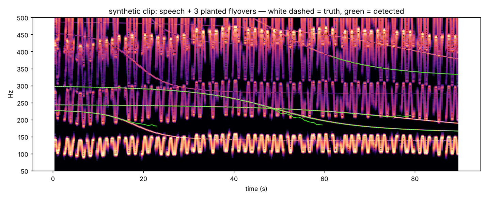

# No Contrail

**Audit your own recordings for aircraft-Doppler location leaks. Then scrub them.**

[nocontrail.audio](https://nocontrail.audio) · engine: `contrail` (Python, MIT) · app: coming

Your audio never leaves your machine.

Aircraft flying overhead — often too far away to hear — leave slowly drifting
tonal lines in the background of a recording. Matching the shape of those
Doppler curves against public ADS-B flight data can pin down where a video was
recorded to roughly a city block. Ordinary noise reduction and high-pass
filtering do not remove it, because the signature is the *pitch drift*, not a
frequency band.

This repo is the defensive side of that problem. `contrail` is the engine: it finds the lines in audio
*you* own, fits them to a physical flyover model, and (soon) gives you a
scrubber that destroys the signature without wrecking the voice.

> **Scope, deliberately.** This repo contains the detector and the physics.
> It does **not** contain a locator, an ADS-B matcher, or anything that turns
> someone else's video into coordinates. The fit here recovers a flyover's
> speed, miss distance and emitted frequency relative to the microphone — not
> the microphone's position on Earth. That is enough to tell you whether a clip
> leaks, and nothing more. Please keep it that way in forks.

## Status: early prototype

Validated only on synthetic clips (synthetic speech + planted flyovers).
On that bench: 14 of 15 planted flyovers recovered across five random clips;
30 of the 32 tracks returned sit on a planted line or harmonic (the other two
are short fragments that drift a few Hz off one); parameter estimates on long
tracks land within a few percent of truth. ~20 s per 90 s clip, unoptimised. No real-world audio has been tested yet. The one miss is a
fundamental sitting inside the talker's pitch band, which is the case VAD
gating (next on the list) is meant to handle.



## What's here

```
contrail/             the engine (pip install contrail)
contrail/doppler.py   exact retarded-time Doppler model for a straight flyover
contrail/synth.py     synthetic test-clip generator (fake speech + planted planes)
contrail/detect.py    STFT → whitening → sub-bin peak tracking → fragment merge
                      → physical fit → split-and-refit for crossing lines
contrail/scrub.py     gate / notch / decoy tiers, verified by re-detection
contrail/cli.py       `contrail audit <wav>`, `contrail scrub <in> <out>`
scripts/validate.py   plants flyovers, scores recovery, renders the spectrogram
scripts/scrub_bench.py before/after per scrub tier
scripts/group_bench.py scores line-to-plane grouping against planted truth
```

## Scrubbing

Three tiers, all in the same STFT domain the detector uses, so what the
scrubber touches is what a detector sees. Default is all three.

| tier | what it does | synthetic bench (9 planted lines, 3 clips) |
|---|---|---|
| `gate` | in frames with no voice activity, attenuate < 500 Hz by 40 dB | 9/9 lines survive |
| `notch` | for each detected ridge and its harmonics, zero a ±2.5 Hz band that follows the ridge frame by frame | 1/9 survive |
| `decoy` | mix in 8 synthetic flyovers with random plausible parameters, at the measured level of the real lines | 7/9 survive, 13/24 decoys detected |
| all | | 1/9 survive, 16/24 decoys detected |

What that table says:

* **Gating alone is weak** when the talker's pauses are short. The tracker
  bridges gaps under a second. It gets better with real speech (longer
  pauses) and a real VAD, but don't rely on it by itself.
* **Notch does the work** — but only on lines the detector found. The 1/9
  survivor was never detected, so was never notched. Scrub quality is capped
  by detector recall. That's the argument for keeping the two in one repo.
* **Decoys don't remove anything**; they make a fitter's job ambiguous. On
  their own, a fitter still gets the real lines. Together with notch, what's
  left is mostly fake.

```bash
python -m contrail.cli audit demo/synthetic_leak.wav
python -m contrail.cli scrub demo/synthetic_leak.wav demo/scrubbed.wav --decoys 12
```

The notched audio correlates > 0.9 with the input in the voice band — the
notches are a few Hz wide and well below the formants. Listen anyway.

### Why the detector is shaped this way

* **1 s STFT windows.** Aircraft lines drift at a few Hz/s; voice harmonics
  jump tens of Hz between syllables. Long windows give 1 Hz bins and smear
  speech into a blur while the planes stay sharp.
* **Per-frame spectral whitening** (running median along frequency) so the
  loud voice bands don't swamp a line 24 dB below them.
* **Slope-predictive linking**, downward only. A receding plane never goes
  up in pitch, so the tracker is allowed to assume that.
* **Physical fit as the gate.** Every candidate is fitted to the retarded-time
  flyover model (`f0`, ground speed, slant miss distance, time of closest
  approach). Anything that doesn't fit a plane to < 1 Hz RMS is dropped. This
  is what killed the false positives — a smoothness test alone was not enough.
  Note the fit must include propagation delay: at 2.5 km the delay varies by
  ~6 s over a flyover and visibly warps the curve.
* **Merge, then split.** Speech harmonics sweep across the 200–400 Hz band and
  steal peaks, fragmenting lines right at closest approach where they are
  steepest. Fragments are rejoined when a joint fit stays tight. Conversely,
  when two real planes cross, the greedy linker can glue them; a rejected long
  track is split at the point that minimises the two half-fits.

## Run it

```bash
git clone https://github.com/doInfinitely/nocontrail
cd nocontrail && pip install -e .[plot]
python scripts/validate.py demo
```

Writes `demo/synthetic_leak.wav` and `demo/spectrogram.png`, and prints
recovery stats per seed.

```python
from scipy.io import wavfile
from contrail.detect import find_tracks, leak_score

sr, y = wavfile.read("my_clip.wav")
y = y.astype("float32") / 32768
if y.ndim == 2:
    y = y.mean(axis=1)
tracks = find_tracks(y, sr)
for t in tracks:
    print(t)
print("leak score:", leak_score(tracks))
```

## Roadmap

1. **VAD gating** — tried and shelved. A `DetectConfig.vad` energy-VAD band-gate
   is in the code but **off**, because validating it on real speech (a 135 s
   own-voice recording + planted flyovers) showed it never beats VAD-off: turn
   it up and it deletes the aircraft lines that share the speech band; turn it
   down and it barely fires and adds spurious tracks. Across ~48 min of real
   speech (3 recordings, 12 windows), VAD-off gave the fewest spurious tracks at
   equal recovery (29/36). The
   real fix is a learned VAD (silero/webrtcvad) plus a targeted rejection of
   peaks that coincide with a tracked voice harmonic — not a blanket band gate.


2. **Group harmonics by flyover** — done, on synthetic clips. Lines join a group
   when their measured frequency ratio snaps to a small integer ratio and one
   flyover model fits them jointly. The leak score now counts planes, not lines.
   Held-out seeds 8-15: 16/16 grouped pairs on the same plane, 16/23 same-plane
   pairs grouped. Missed merges overcount planes, usually where the tracker has
   glued lines together. One-plane clips with several lines scored about 0.33,
   down from as high as 0.95.
3. **Real VAD** (silero) in place of the energy gate; also use it in the
   detector so peaks are only picked from speech-free frames.
4. **Real audio** — the whole thing needs a bench of real recordings with
   known flyovers before anyone trusts the numbers.
5. Optional ADS-B lookup of *your own declared position* to turn "a plane
   passed" into "this plane, at this time", for a stronger leak estimate.

## Background

Technique described by Colsto (Nov 2026), reported by
[TechRadar](https://www.techradar.com/computing/cyber-security/youtuber-discovers-aircraft-noise-trick-that-can-geolocate-your-videos-to-within-100m-doppler-effect-pinpoints-locations-from-just-60-seconds-of-audio).
Colsto deliberately did not release code. This project follows that choice.

## Reporting a problem

security@nocontrail.audio for anything that could put a creator at risk; issues for everything else.

## License

MIT
